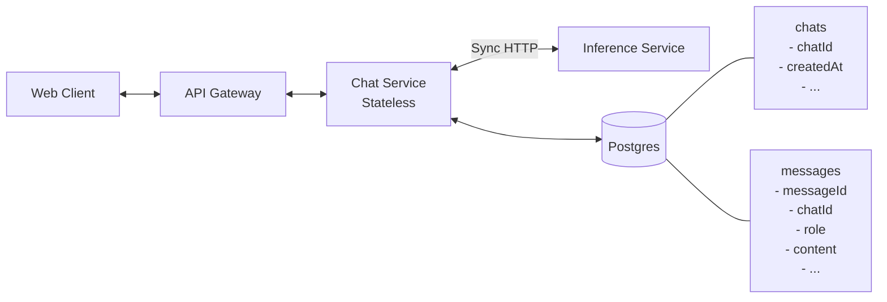
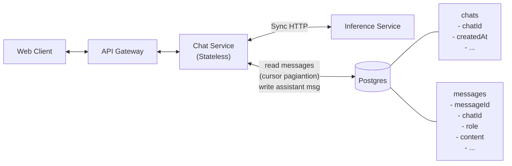
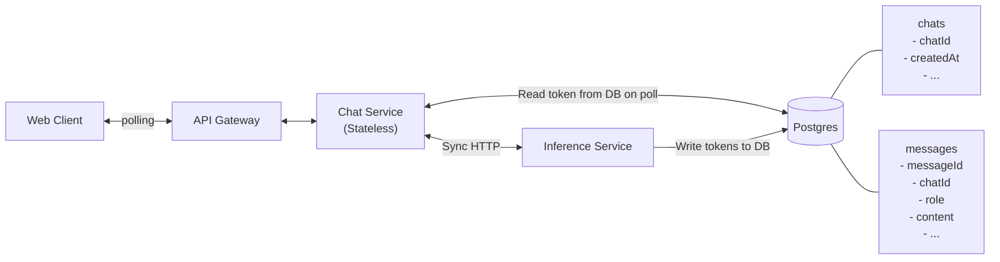
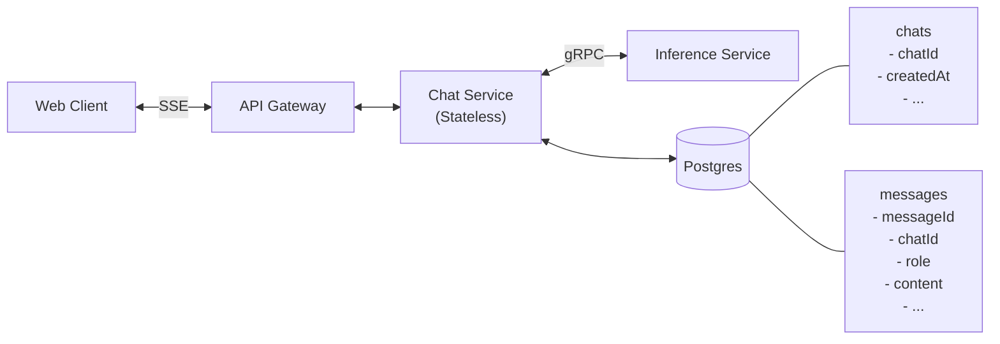
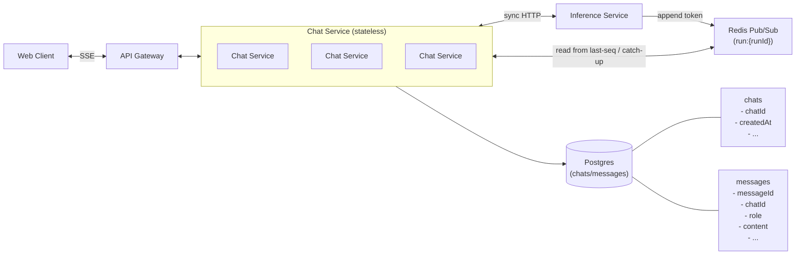

# Design ChatGPT

## 1 Understanding the Problem

It's a conversational AI product where users send prompts in natural language and get responses streamed back from a large language model. Conversations are saved, so users can come back to an old chat and pick up right where they left off.

## 2 Functional Requirements

1. Users should be able to send a prompt in a chat and receive an AI-generated response.
2. Users should be able to view past chats and resume a conversation, with the chat's prior context carried into the prompt.

## 3 Non-Functional Requirements

1. The system should have low time-to-first-token (< ~500ms).
2. The system should be fault tolerant, recovering an in-flight stream without dropping tokens when a connection drops or a server fails.
3. The system should prioritize availability over strong consistency for conversation state (~99.9%+).
4. The system should scale under GPU-constrained capacity, with fair allocation across a tiered user base (free, Plus, Pro).

## 4 Defining the Core Entities

To satisfy our functional requirements, we'll need the following entities:

1. User: An account on the platform. Carries the tier (free vs paid), which is going to matter a lot once we get to fairness and scheduling.
2. Chat: A single conversation thread. Belongs to one user, groups an ordered sequence of messages, and carries a title and timestamps.
3. Message: One turn in a chat, either a user prompt or an assistant response. Carries the chatId, a role (user or assistant), the content, and a token count.

## 5 API or System Interface

The API is the contract between the client and our system, and it's the bridge into the high-level design. We'll define one or two endpoints per functional requirement and keep moving.
First, a user starts a new chat. We use POST because we're creating a new Chat entity.

```
POST /chats -> {chatId}
Body: {}
```

Next, the user sends a prompt. We use POST because we're creating a new Message and starting the model response on the server.

```
POST /chats/{chatId}/messages -> Message
Body: {
  content
}
```

For the second functional requirement, we list a user's chats for the sidebar and load the messages for one chat. Both are GETs with cursor pagination, since a heavy user can have thousands of chats and a long chat can have thousands of messages.

```
GET /chats?cursor={cursor}&limit={n} -> Chat[]
GET /chats/{chatId}/messages?cursor={cursor}&limit={n} -> Message[]
```

> Notice the userId never shows up in a path or body. It comes from the session token or JWT, and chat ownership is checked server-side on every request. Passing userId in the body is a classic red flag, since anything the client sends can be forged.

## 6 High-Level Design

### 6.1 Users should be able to send a prompt and receive an AI-generated response



1. **Web Client**: The browser or mobile app where the user types prompts and reads responses. It's the chat UI.
2. **API Gateway**: The entry point for all client requests. It handles authentication, rate limiting, and routes requests to the right service.
3. **Chat Service**: A stateless service that owns chat and message persistence and orchestrates the call to the model. It's cheap to run and easy to scale horizontally, which matters because we'll want to scale it independently from the expensive inference layer.
4. **Postgres**: Our system of record, holding the chats and messages tables. The data is simple rows keyed by chatId and userId, so almost any database would work here. We reach for Postgres as a sensible default rather than because anything about the problem demands a relational store.
5. **Inference Service**: The pool of GPU machines that actually run the LLM. Each one runs a model server with the weights resident in its GPU memory, and those machines are what we'll call workers from here on. There's no tier in between, a request goes to a worker and that worker generates. We treat the model itself as a black box that takes a prompt in and returns a completion. This is the expensive, GPU-bound part of the system, separated from the Chat Service so we can scale and schedule it on its own.

The split between Chat Service and Inference Service is the one design decision to dwell on here. The chat tier is cheap and stateless, while inference is GPU-bound and expensive, and since we'll want to scale the two independently, we separate them now.

The obvious problem is that this is fully synchronous, so the client sits on that HTTP call until the entire response is generated, and a long response can take up to 30 seconds. That's 30 seconds of blank screen, which violates our TTFT requirement and feels broken.

On top of that, the Chat Service calls a GPU worker directly with no admission control. Nothing decides which requests to accept or turn away when the workers are already full. That breaks down the moment GPUs become the bottleneck. We'll fix the first problem with streaming and the second with a scheduling layer, both in the deep dives. For now, it works.

### 6.1 Users should be able to view past chats and resume a conversation with context carried across turns

Users expect to come back tomorrow, scroll their old conversations, open one, and keep going as if the model remembers everything. Two things have to happen here, a read path for past chats and context carry-over on the next turn.
We don't need any new services for this. We add the read endpoints off the existing Postgres tables and a context-loading step inside the Chat Service.



For the read path:

1. GET /chats returns the user's chats ordered by recent activity, cursor-paginated for the sidebar.
2. GET /chats/{chatId}/messages returns one chat's messages, cursor-paginated so a long conversation doesn't load all at once.

For context carry-over, when the user sends a follow-up prompt on an existing chat:

1. The Chat Service queries the messages table for the prior messages in that chatId, ordered by creation time.
2. It builds the prompt by concatenating those messages (with their roles, user vs assistant) followed by the new user message.
3. It sends that combined prompt to the Inference Service, just like the first turn.
4. The new assistant message gets written back to the messages table, so the next turn can read it too.

This is the simplest thing that works. The model sees the whole conversation every turn, so it behaves like it remembers. But sending full history every turn has two obvious problems. It breaks once a conversation grows past the model's context window, and it gets more expensive every turn since input tokens are billed per call. We'll tackle that with summarization and prefix caching in the deep dives.

That gets us a working system. It satisfies both functional requirements and has the bottlenecks our non-functional requirements warned us about. Let's go fix them.

## 7 Deep dives

### 7.1 How do we stream tokens back to the client?

Our synchronous design makes the user wait up to 30 seconds for a blank screen to turn into a full answer. Fixing that means putting tokens on the screen as the model produces them, and there are two connections involved. One runs from the client to the Chat Service, and the other from the Inference Service back to the Chat Service.

Let's take the second one as given for now and assume the worker hands tokens back as it generates them over a server-streaming gRPC call. gRPC is a framework for service-to-service calls that runs over HTTP/2. The Chat Service makes one call, and the worker streams messages back over that open connection, one token at a time. A plain request/response call wouldn't do, since it would force the worker to buffer the entire 30-second completion and hand it back in one lump, which is the blank screen all over again. We reach for gRPC rather than WebSockets on this internal hop because we want HTTP/2's binary framing and multiplexing between our own services, and protocol buffers give us a typed contract on top of that.

That leaves the half the user actually sees, which is how the Chat Service gets that stream down to the browser.

#### 7.1.1 Bad Solution: Polling for Chunks

**Approach**

The client fires off the prompt and then polls a status endpoint every few hundred milliseconds, asking, "Any new tokens yet?" The server answers with whatever has been generated since the last poll. For that to work, the tokens from the inference worker have to sit somewhere the polled endpoint can read them. So we need a buffer between the worker and the Chat Service.

We could buffer in Redis, which is fast but drops everything if it restarts. Or we could write each chunk to Postgres, which is durable but turns one response into hundreds of tiny writes against our system of record. We'll take Postgres for the sake of argument, recognizing neither is a good idea.



**Challenges**

Polling is bad for the exact metric we care about. Time-to-first-token is gated by the poll interval, so a 500ms poll adds up to 500ms of dead time before the first token can even appear. It's also wasteful. At 120k concurrent streams, polling every 300ms is 400k requests per second, and the overwhelming majority of those come back empty.
And the experience is lumpy. Instead of tokens flowing one at a time, the user gets them in batches on each poll, which kills the smooth typing illusion that makes the product feel alive. The fix for all three problems is the same idea, stop asking and let the server push.

#### 7.2 Good Solution: WebSockets

**Approach**

Instead of the client asking over and over, we open one persistent connection and let the server push tokens the instant they exist. On the browser side that connection is a WebSocket between the client and the Chat Service instance that handled the prompt. It's a full-duplex channel that stays open for the life of the generation.

The result is two streams chained through one Chat Service instance. The worker sends tokens to it over gRPC, and it relays each one down the WebSocket to the browser. Time-to-first-token is now bounded by how fast the model produces the first token rather than by any poll interval, and the flow is smooth because each token is forwarded the moment it arrives.also

**Challenges**

This works well, and for plenty of realtime features it's the right call. But it's more than this particular job needs. A WebSocket is bidirectional, and during a generation we only ever push one way, from server to client. The client doesn't send anything back over that channel once the prompt is in flight.

We'd be taking on a stateful, two-way protocol, including its upgrade handshake and per-connection bookkeeping. Every load balancer and proxy in the path also has to speak WebSocket. That's a lot to carry when we only use one direction. There's a lighter option built for this exact shape.

#### 7.3 Great Solution: Server-Sent Events

**Approach**

Server-Sent Events are purpose-built for one-way server-to-client streaming. The client opens an ordinary HTTP request with an EventSource. The server holds that response open and keeps writing data: events to it as tokens are produced, and the browser fires an event for each one.

It runs over plain HTTP with no protocol upgrade, so every proxy and load balancer in the path already handles it. The browser starts rendering on the very first event. As a bonus, the EventSource API reconnects on its own when a connection drops, which we'll lean on in the next deep dive.

For pushing tokens to a browser this is the right tool. We get the same instant first token and smooth flow as a WebSocket without paying for a bidirectional channel. The backend is unchanged from the WebSocket option. The Chat Service still receives tokens from the worker over the gRPC stream and relays them, only now it forwards over SSE instead of a WebSocket.



Before we wire this up, we need a name for the thing being streamed. Our entities so far are User, Chat, and Message, and none of them fit. A message is the finished text, while what we're streaming is an attempt to produce it, and that attempt has a lifecycle of its own. It can be queued, it can run, it can fail halfway through, it can be cancelled, and it can be retried, all before there's a completed assistant message to write down.

So we add a runs table. A Run is one attempt to generate an assistant response. The Chat Service creates it with a fresh runId when the user's message lands, before inference starts. The row carries the chatId and messageId it belongs to, a status that moves from queued to streaming and then to done, cancelled, or failed, the model that served it, and the input and output token counts we'll lean on for billing and quotas.

That `runId` is what reshapes the message endpoint from the API sketch. `POST /chats/{chatId}/messages` no longer waits around for the model. It creates the Run and returns { runId } immediately, and the client follows the tokens on a separate GET /runs/{runId}/stream. Keeping that stream on a GET matters because the browser's native EventSource API only opens GET requests.

Everything we build in the deep dives ahead, the queue, the workers, and the cancellation path, refers to the same run.

That gives us a simple first version of streaming.

1. The Chat Service persists the user's message, creates a Run, and returns the runId to the client right away.
2. The client opens an SSE connection for that runId.
3. The Chat Service sends the assembled prompt to the Inference Service, and the worker streams tokens back over gRPC as it generates them.
4. The Chat Service forwards each token down the SSE connection, and the browser appends it.

The user starts reading the answer as soon as the model starts producing it rather than waiting 30 seconds for the whole thing.

### 7.2 How do we keep the stream alive across reconnects and deploys?

That works, but it assumes one fixed server sits between this user and the model for the full 30 seconds. The Chat Service instance holding the SSE connection is also the one holding the gRPC stream from the worker, so one specific instance has to sit in the middle for the entire generation. Our Chat Service tier is stateless, horizontally scaled behind a load balancer, and redeployed all day long, which makes that instance disappearing mid-generation routine.

What we want is to separate the worker producing tokens from the Chat Service instance delivering them. The worker shouldn't need to know which instance is holding the user's connection, and when a client reconnects and lands on a different instance, that instance should be able to pick up the same run where the last one left off.

#### 7.2.1 Good Solution: Separate With Redis Pub/Sub

**Approach**

We can separate the two sides by putting something in between them rather than wiring a Chat Service instance straight to a worker. Concretely, we add a pub/sub between the workers and the Chat Service tier, keyed by the runId.

The inference worker publishes each token to the channel for that runId. The Chat Service instance holding the client's SSE connection subscribes to that channel and forwards tokens down to the browser. The worker no longer cares which Chat Service instance is connected, and the Chat Service no longer cares which worker is generating.

A client can now reconnect to a different Chat Service instance, and that new instance just subscribes to the same channel. A deploy or a crash no longer kills the stream outright. [Redis](https://www.hellointerview.com/learn/system-design/deep-dives/redis#redis-for-pubsub) Pub/Sub is the natural fit.

We publish each token as a delta, not the full message-so-far. Republishing the cumulative text on every token would be quadratic. A 4,000-token answer would re-send a steadily growing prefix 4,000 times, and at 120k concurrent streams with answers up to 30k tokens that bandwidth is a non-starter. Deltas put each token on the wire exactly once.



**Challenges**

Pub/Sub is fire-and-forget. It delivers a message only to the subscribers connected at the instant it's published, and it buffers nothing.

So picture the window between the old Chat Service instance dropping and a new one subscribing, which is what a deploy or a crash creates. The worker keeps publishing tokens, and there is simply no subscriber to receive them. Tokens published during that gap are permanently lost. The user is left with a hole in the middle of their answer that doesn't fill in until generation finishes and the client refetches the completed message.

#### 7.2.2 Great Solution: Separate With Redis Streams and Replay

**Appraoch**

Keep the runId-keyed channel, but swap the fire-and-forget Pub/Sub for a Redis Stream, which is an append-only log that remembers its entries. Every entry gets an ID, so a consumer can ask for everything after the last entry it saw. The worker XADDs each token delta to the stream for that runId. The Chat Service instance reads with a blocking XREAD starting from the last entry ID this client has already seen. It forwards new entries down the SSE connection and keeps track of the latest ID as it goes.

The reconnect case is now clean. When a client drops and reconnects to a different Chat Service instance, that instance resumes its XREAD from the client's last-seen ID. It replays exactly the entries that were missed during the gap, then continues live. No hole, no waiting until the end, and the user sees one continuous response even though both the connection and the Chat Service instance behind it changed.

We keep the cost bounded with MAXLEN, so each stream retains only a recent window of tokens rather than growing without limit. We also give the stream a short TTL so it's reclaimed once the generation is done. Memory stays capped, and each token still crosses the wire once because we're sending deltas rather than snapshots. The stream is short-lived working state, not a second copy of history.

To be clear about durability, the stream is not our system of record. When generation finishes, the worker writes the complete assistant message to Postgres and marks the Run done, and that persisted message is the durable copy a client can always refetch. The Redis Stream exists only to keep the live stream free of gaps across reconnects, which is why per-token durability stays below the line even though we briefly retain tokens here.

Here's the full flow when a user sends a prompt:

1. The Chat Service persists the user's message and creates a Run with a fresh runId, returning it to the client right away.
2. The Chat Service hands the assembled prompt and that runId to an inference worker, which starts generating.
3. The client opens an SSE connection for that runId, and the load balancer routes it to any Chat Service instance.
4. That Chat Service instance starts a blocking XREAD on the runId stream, from the beginning for a fresh connection or from the client's last-seen entry ID on a reconnect.
5. The inference worker generates tokens and XADDs each one to the runId stream.
6. The Chat Service instance reads new entries, forwards them down the SSE connection, and the browser appends them. If the connection drops, the browser reconnects, lands on some Chat Service instance, and that instance replays from the last-seen ID before continuing live.

Notice how much step 2 glosses over. The Chat Service hands the prompt to a worker and it starts generating, as if there's always one sitting idle waiting for it. At 20k prompts per second against a pool of GPUs we can't add to on demand, there often isn't.

### 7.3 How do we route and schedule generation requests across GPU workers?

GPUs are the bottleneck. They're the most expensive resource in the system and the one in shortest supply, so how we route work to them decides both our cost and our latency under load.

The scale of that expense is easy to underestimate. A frontier model is far too big to fit on a single GPU, so its weights get split across all the GPUs in one server, typically eight of them. Serving 120k concurrent streams means standing up thousands of those servers. That puts you at tens of thousands of GPUs for this one model, and the labs running systems at this scale spend staggering amounts on compute, easily hundreds of millions to billions of dollars a year.

When the hardware costs that much, every percentage point of unused capacity is real money.

#### 7.3.1 Good Solution: Queued Worker Pool

**Approach**

Put a request queue between the Chat Service and the GPU workers. The Chat Service enqueues a generation request (prompt plus runId) and returns fast. Inference servers pull from the queue when they have capacity, generate, and append tokens to the runId stream from deep dive 2. This is pull-based, so a server only takes new work when it can actually do it.

The queue buys us room between a spiky front end and a fixed-rate back end. Prompts arrive in bursts, up to 20k per second at peak. The worker pool can only work through requests as fast as its GPUs allow, which is a much lower, more even rate. With nothing in between, a burst either overwhelms the workers or gets dropped. The queue absorbs the spike and lets it drain at whatever pace the workers can sustain, so a surge becomes a few seconds of extra wait instead of a pile of errors.

**Challenges**

This handles bursts much better, but a plain queue still leaves two problems. The queue is unbounded, so while it absorbs a temporary spike, sustained demand above what the workers can handle just makes the line grow without limit. A user can end up sitting behind thousands of queued requests with no idea whether their answer is two seconds away or two minutes. We need a way to cap that wait and tell the user honestly when we're too busy, rather than leaving them on a spinner forever.

On top of that, the queue still treats each generation as an independent job on a worker, which leaves a lot of GPU performance unclaimed. GPUs are most efficient when they process many sequences together, and one-request-per-worker-slot doesn't exploit that.

#### 7.3.2 Great Solution: Queue Plus Continues Batching and Backpressure

**Approach**

Keep the queue and pull-based workers, then add continuous batching. Instead of giving the GPU one request at a time, each worker runs many active sequences together. During decoding, a single forward pass can generate the next token for every sequence in the batch.

The batch changes continuously. When one sequence finishes, the worker removes it and pulls another request from the queue into the newly available slot. That avoids waiting for an entire batch to finish before starting new work.

```
GPU batch

Request A -> token 42
Request B -> token 17
Request C -> token 91
Request D -> token 8

one forward pass

Request A -> token 43
Request B -> token 18
Request C -> finished
Request D -> token 9

next pass

Request A -> token 44
Request B -> token 19
Request E -> token 1
Request D -> token 10
```

This is what makes batching so important for GPU utilization. A single decoding sequence often cannot use all of the GPU's parallel compute, while processing many sequences together gives the GPU much more work to do at once. One replica can therefore keep dozens or more sequences in flight rather than serving them serially.

Why batching improves utilization this much comes down to how GPUs execute model inference, which is worth its own aside just after these options.

Lastly, we can add backpressure so the system degrades predictably instead of collapsing. Give the queue a bounded depth and an admission policy. Once the queue is too deep, reject, defer, or shed new requests rather than allowing latency to grow without bound.

The goal is to put an upper limit on how much work the system is willing to accept. Users either enter a queue of manageable size or get a fast "we're at capacity, try again" instead of joining an ever-growing backlog and waiting indefinitely.

Putting it together:

1. The Chat Service enqueues a generation request with its runId and a token-cost estimate.
2. Admission control checks queue depth. If we're over the limit, the request is shed or deferred (the fairness deep dive covers how tiers change that order).
3. A GPU worker pulls the request and folds it into its running batch via continuous batching.
4. The worker streams tokens to the runId stream as the batch generates.
5. When generation finishes (or is cancelled), the worker drops the sequence from its batch and pulls the next request.

**Challenges**
The tradeoff is a more complex serving layer, which now has to juggle variable-length sequences entering and leaving a batch. A batch of wildly different prompt lengths can still leave some GPU work idle. The inference framework handles most of this for you, but the worker is still much more involved than "run one prompt."

The remaining product decision is which requests to reject when capacity is full.

> A GPU keeps the model's weights resident in its high-bandwidth memory, but the compute units can't do math on them there. They work out of a tiny pool of on-chip memory that's nowhere near big enough to hold billions of weights. So every forward pass has to stream the entire weight set from high-bandwidth memory through the compute units just to produce a token.
  
  Picture the weights as parts in a warehouse and the compute as a tiny workbench. The parts never leave the building, but to build anything you still have to haul the full set from the warehouse over to the bench. For a single token you make that whole haul and then do a trivial amount of assembly, one vector's worth of math. The bench sits idle most of the time, waiting on the next load. That's what people mean when they call token generation memory-bandwidth bound.
  
  Batching makes each haul pay off. Bring the same parts to the bench once, then fill many orders before sending them back. The worker runs a batch of sequences together and each forward pass advances all of them by one token. We stream the weights once and get dozens of tokens out of it instead of one.
  
  The "continuous" part keeps the batch full. A fixed batch would wait for every sequence to finish before starting the next. But a one-line reply can sit next to a 2,000-token essay, so the batch drains and the GPU drifts back to idle while the slowest sequence runs on alone. Continuous batching evicts a sequence the moment it finishes and slots in a queued one. That's how production inference servers like vLLM and TGI keep a replica busy with dozens of sequences at once.

### 7.4 How do we keep heavy users from taking over the GPU pool while giving paid tiers a better experience?

This is a multi-tenant system sharing one limited GPU pool, and the costs are wildly uneven. One user firing a 30k-token prompt burns far more compute than a hundred users sending one-liners. We need fair sharing so nobody can starve everyone else, and we need business priority across tiers so paying customers get a better experience when things are tight. A flat requests-per-minute cap can't express either of those.

#### 7.4.1 Bad Solution: Flat Global Rate limit

**Approach**

The simplest fix is a single global rate limit, one requests-per-minute cap covering all traffic. The mechanism is the standard API rate limiter sitting at the API Gateway, where it can turn a request away before it costs us anything. One counter, an atomic increment-and-check on each request, and a 429 once the count crosses the limit for the current window. Because our app tier is stateless and horizontally scaled, that counter has to live somewhere shared, which in practice means Redis.

**Challenges**

One counter for everyone means the limit has no idea who is asking. A single user hammering the API burns through the global budget, and everyone else starts collecting 429s for traffic they didn't send. That's the starvation problem we came here to solve, now enforced by our own rate limiter.

#### 7.4.2 Good Solution: Per-User Limits

**Approach**

The fix is the same machinery as before, just keyed differently. Instead of one global counter, we key the limiter by userId, so every user gets their own bucket and one user's flood can't drain everyone else's capacity.

For a concurrency cap, that's a per-user counter in Redis, incremented when a generation starts and decremented when it finishes or is cancelled. Before admitting a new generation we check that user's counter. If they're already at their cap, we reject or queue the request until one of their in-flight generations frees up.

The only thing that really changed from the global limit is the key, from one shared bucket to one bucket per user. But that's the change that stops a single heavy user from starving the pool.

**Challenges**

This fixes the starvation problem because one user can no longer take over the pool. But it's still counting requests, not cost. A per-user cap of "5 in-flight generations" treats five 50-token replies the same as five 30k-token generations, even though the latter use orders of magnitude more GPU. And on its own it still doesn't give paid tiers a meaningfully better deal. We need to meter actual cost and bake tiers into the scheduling.

#### 7.4.3 Great Solution: Cost-Aware Quotas with Tier Priority

**Approach**

The fix is to meter what's actually limited, which is tokens rather than request count. We already have both numbers. The input tokens are known exactly once the prompt is assembled, and the output tokens come back one at a time down the stream we built in deep dive 2, which is why the Run row records both.

So the limiter is the same token bucket as before, keyed by userId, refilling at a rate set by the user's tier. The check moves off the API Gateway and into the Chat Service, since the gateway only sees a raw request while the Chat Service is what assembles the prompt and therefore knows what it will cost. On admission it debits the exact input count and reserves the requested max output. When the run finishes, the worker writes the true output count to the Run row and the unused part of the reservation goes back to the bucket. Because we reserved the worst case up front, a run can never cost more than the user could afford when it started, so we never have to kill a stream mid-sentence to stay inside a budget.

Then layer tier priority on top. Paid users get bigger budgets, higher concurrency limits, and higher priority in the queue from deep dive 3. Concretely, the queue becomes tier-aware: paid requests are pulled ahead of free requests when workers free up. Under normal load everyone's served fast and nobody notices; the tiers only diverge when capacity is tight, which is when paying customers should feel the difference.

**Challenges**

The imperfection is in the reservation rather than the accounting. We hold the full max output against the budget even though most answers come back far shorter, so a user's throughput is bounded by their worst case instead of their average. Reserve too tightly and you truncate real answers, too loosely and the budget stops meaning much.

There's also a trade off between fairness and utilization. Strict tier priority can leave free users waiting for long stretches during sustained peaks. In practice, you reserve a floor of capacity for free traffic rather than letting paid traffic fully crowd it out. Product and infrastructure teams tune these policy choices together.

### 7.5 As conversations get longer, how do we control inference cost without making the assistant feel forgetful?

Recall our high-level design replays the entire conversation into the model on every turn. It works, but its cost and latency grow with the chat.

A 50-turn chat at ~500 tokens per turn means we're shipping ~25k input tokens on the next prompt, all billed per call. Worse, it has a hard ceiling. Once the conversation grows past the model's context window the request simply can't fit.

Real assistants usually just surface this, telling you the chat has gotten too long rather than failing silently. But leaning on that as your only answer means the product stops working for the power users who chat the most. It's fine for a five-turn chat and untenable as a general approach. What we want is to keep the assistant feeling like it remembers without paying to re-read the whole transcript each time.

#### 7.5.1 Good Solution: Truncation

**Approach**

Keep only the most recent N turns and drop everything older. The prompt stays a fixed, bounded size no matter how long the conversation runs. Concretely, this is just a bounded read against the messages table instead of pulling the whole thread.

```
SELECT * FROM "messages"
WHERE "chatId" = $1
ORDER BY "createdAt" DESC
LIMIT $2
```

We pull the newest N rows, then flip them back into chronological order before assembling the prompt.

**Challenges**

It bounds cost, but the assistant becomes obviously forgetful. Reference something from earlier in a long chat and it has no idea what you're talking about, because that turn was dropped. For a product whose whole appeal is "it remembers the conversation," abrupt amnesia at turn N+1 is a bad look. We want bounded cost without the visible memory loss.

#### 7.5.2 Great Solution: Prefix Caching and a Rolling Summary

**Approach**

The biggest win is prefix caching. Across turns in a single conversation, most of the prompt is identical from one turn to the next, since the system prompt and everything already said in the chat all repeat. Modern inference servers can cache the model's intermediate state (the KV cache) for a stable prompt prefix and reuse it instead of recomputing it from scratch every turn.

Only the tail of the prompt, the newest message, actually changes. Prefix caching therefore cuts both the cost and the latency of processing the input, which helps our TTFT goal directly. It pairs naturally with conversation-aware routing that sends each turn to a worker where its prefix is already warm.

The catch is that the cache has to be managed. A worker has finite memory and can only keep so many conversations' prefixes warm at once, so prefixes are evicted on something like an LRU basis. A conversation that goes quiet and comes back later finds its prefix cold and pays full price to rebuild it on that next turn.

Prefix caching makes re-reading the history cheap, but it doesn't move the hard ceiling. A conversation can still outgrow the context window no matter how cheaply we process it. That's where a rolling summary comes in.

Keep the most recent turns verbatim and compress older history into a running summary. The prompt becomes the system prompt, then the summary of older turns, then the last few turns word-for-word, and finally the new user message. Recent context, where most follow-ups point, stays exact, while older context is preserved in compressed form. The assistant still remembers the gist of a long conversation without carrying every word.

The summary updates in the background as the conversation grows, folding the oldest verbatim turns in as they age out. The summary keeps the prompt inside the window, and prefix caching keeps the stable part cheap to process.

You can add more if needed. Retrieving only the older facts relevant to the current turn (instead of summarizing everything) is one option, and hard caps on extremely long chats for free-tier users (tying back to the fairness deep dive) is another.

**Challenges**

Summarization isn't free, since it's an extra (cheaper) model call. A summary can also lose a detail that turns out to matter later, so there's a real quality-vs-cost tension. The guiding principle is to protect the most recent turns and the most important user context first, and accept some lossiness on old history.

Prefix caching also depends on the prefix actually staying stable. If we rewrite the summary every turn, we invalidate the cache, so we update it on a slower cadence to keep the prefix warm. Every cost lever here trades a little answer quality or memory fidelity for a lot of cost. The design should spend that tradeoff on old, low-value context rather than recent, high-value context.

#### 7.5 Cancelling a run and reclaiming the GPU

The one operation on a Run we haven't shown yet is cancellation, and it's the clearest payoff for having made the run first-class. When the user hits stop, the client makes a plain HTTP call to POST /runs/{runId}/cancel. SSE only pushes one way, so anything the client needs to send mid-stream travels over a separate request like this one. The Chat Service flips that Run's status to cancelled and publishes a cancel signal on a control channel keyed by the runId. The worker checks that channel between token batches, and the moment it sees the signal it drops the sequence and stops generating.

Cancellation immediately frees capacity that would otherwise stay occupied for the rest of the 30-second generation. GPU capacity is the most limited and expensive resource in the whole system, so reclaiming it the instant the user stops caring is real money back.

Worth being clear that closing the tab is not a cancel. We built the Redis Stream and SSE reconnect precisely so a dropped connection isn't read as the end of a run, and like ChatGPT we keep generating in the background. The user can reopen the chat and reconnect to the stream, or just refetch the finished message from Postgres once it's done. Cancellation has to be an explicit signal from the user, never an accident of the network.
